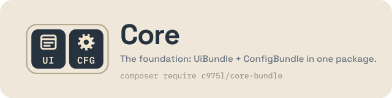
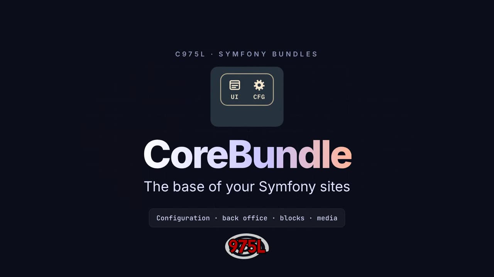
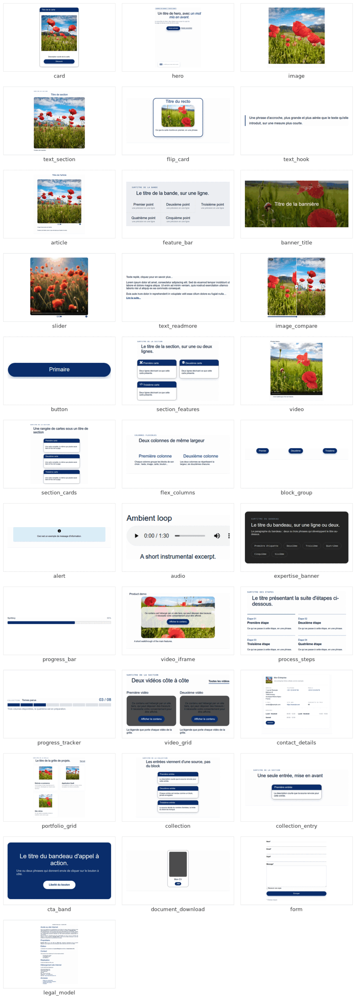

# c975L CoreBundle

[](https://github.com/975L/CoreBundle/blob/main/LICENSE)
[](https://packagist.org/packages/c975l/core-bundle)
[](https://packagist.org/packages/c975l/core-bundle)
[](https://app.codacy.com/gh/975L/CoreBundle/dashboard)

<p align="center"></p>

**Your site gets its settings, back-office dashboard, user accounts, page blocks, media library, forms and emails: the base every other c975L bundle builds on.**

**[Bundle page](https://bundles.975l.com/en/pages/core-bundle) · [Tutorials](https://bundles.975l.com/en/tutoriels/core-bundle) · [Block kinds](https://bundles.975l.com/en/pages/blocks/Ui) · [Live demo](https://bundles.975l.com/demo/) · [Demo back-office](https://bundles.975l.com/demo/login)**

[](https://youtu.be/uOLfj9ymNZo)

▶ [Watch the film](https://youtu.be/uOLfj9ymNZo) · [CoreBundle's page](https://bundles.975l.com/en/pages/core-bundle)

> **TL;DR** — CoreBundle is the base of the c975L ecosystem: settings kept in the database, the back-office dashboard, user accounts and health check on one side, page blocks, media, theme, forms and emails on the other. It ships these as two bundles, ConfigBundle and UiBundle, in a single package with one release. Require the package and register both bundles.

## What you get

- Site settings kept in the database.
- An EasyAdmin back-office dashboard.
- User accounts, a health check and the sitemaps.
- Page blocks to compose a page in the back office, with no template to write.
- A media library, the site's theme and legal models.
- Forms and emails.
- One package and one release for both bundles, keeping the namespaces of the former `c975l/config-bundle` and `c975l/ui-bundle`.

## Quick start

```bash
composer require c975l/core-bundle
```

Then register both bundles as shown in the full [installation](#installation) section below.

## For AI agents

- Skills, read straight from `vendor/c975l/core-bundle/` by a coding agent:
  - ConfigBundle: [`c975l-config`](ConfigBundle/skills/c975l-config/SKILL.md) — where a setting belongs and how to read it · [`c975l-management`](ConfigBundle/skills/c975l-management/SKILL.md) — adding menu entries, alerts and guided projects to the dashboard · [`c975l-operations`](ConfigBundle/skills/c975l-operations/SKILL.md) — sitemaps, redirects, health check and backups · [`c975l-users`](ConfigBundle/skills/c975l-users/SKILL.md) — accounts, roles and access control
  - UiBundle: [`c975l-blocks`](UiBundle/skills/c975l-blocks/SKILL.md) — page blocks and custom block kinds · [`c975l-forms-emails`](UiBundle/skills/c975l-forms-emails/SKILL.md) — forms and emails · [`c975l-js-testing`](UiBundle/skills/c975l-js-testing/SKILL.md) — testing a bundle's JavaScript in a browser · [`c975l-media`](UiBundle/skills/c975l-media/SKILL.md) — uploads, images and site graphics · [`c975l-ui-assets`](UiBundle/skills/c975l-ui-assets/SKILL.md) — stylesheets, scripts, fonts and design tokens
- MCP: ConfigBundle hosts the site's MCP endpoint, `/api/mcp`, where an AI agent works with the tools of every installed c975L bundle, with the rights of its token's account — see [Opening the site to AI agents](ConfigBundle/README.md#opening-the-site-to-ai-agents). UiBundle brings `ui_media_list`, `ui_media_get` and `ui_media_edit` for the media library — see its [MCP tools](UiBundle/README.md#mcp-tools).

## Reference

### Contents

- [One package, two bundles](#one-package-two-bundles)
- [Why they ship together](#why-they-ship-together)
- [Installation](#installation)
- [What the blocks look like](#what-the-blocks-look-like)
- [Documentation](#documentation)
- [Quality checks](#quality-checks)
- [Migrating from `c975l/config-bundle` / `c975l/ui-bundle`](#migrating-from-c975lconfig-bundle--c975lui-bundle)
- [License](#license)

## One package, two bundles

This is **not** a merged bundle. A Composer package is not a Symfony bundle: this package ships the two bundles unchanged, each with its own namespace, its own `services.yaml`, its own `configs.json`, its own translation domain and its own dashboard section.

```text
CoreBundle/
├── composer.json      ← the only one
├── ConfigBundle/      → c975L\ConfigBundle\
└── UiBundle/          → c975L\UiBundle\
```

There is **no `c975L\CoreBundle\` namespace**. The name `core-bundle` exists on Packagist only.

## Why they ship together

ConfigBundle and UiBundle referenced each other in their `composer.json`, in both directions:

- **Ui → Config** is deep and deliberate: `ConfigServiceInterface` is read everywhere, and every `*ProviderInterface` of the generic registry mechanism is declared in ConfigBundle.
- **Config → Ui** comes from the dashboard itself (`FontRegistry`, `FormThemeRegistry`, `StylesheetManagementRegistry`, `ScriptAdminRegistry`, `WhatsNewRegistry`) and from user accounts (`Form`/`FormField` + `EmailService`).

Two packages that require each other cannot be released independently, and neither can see the other's work-in-progress — only its last published version. They were never two layers; they were one layer billed as two. This package says so out loud.

> [!TIP]
> If this project **helps you save development time**:
>
> - [**star** it on GitHub](https://github.com/975L/CoreBundle) — helps others find it
> - [**open an issue**](https://github.com/975L/CoreBundle/issues/new) to share how you use it — genuinely useful feedback
>
> And if you'd like to support the work directly, the **Sponsor** button at the top of the GitHub page is there for that.

## Installation

```bash
composer require c975l/core-bundle
```

Then register both bundles — they remain two entries:

```php
// config/bundles.php
return [
    // ...
    c975L\ConfigBundle\c975LConfigBundle::class => ['all' => true],
    c975L\UiBundle\c975LUiBundle::class => ['all' => true],
];
```

## What the blocks look like



One tile per kind UiBundle ships, captured on the showcase at [bundles.975l.com](https://bundles.975l.com/pages/blocks/Ui), where every one of them is rendered live. A page is composed out of them in the back-office, with no template written for it - see [Built-in block kinds](UiBundle/README.md#built-in-block-kinds) for what each one takes.

## Documentation

Each bundle keeps its own README, unchanged:

- [ConfigBundle](ConfigBundle/README.md)
- [UiBundle](UiBundle/README.md)

Each also ships skills under its own `skills/` directory, written for the coding agent of the site installing the package rather than for someone modifying it — four in ConfigBundle, five in UiBundle, linked into an application's `.claude/skills/` by `c975l:skills:install`. See [ConfigBundle](ConfigBundle/README.md#ai-agent-skills) and [UiBundle](UiBundle/README.md#ai-agent-skills).

Its history, on the other hand, is the package's: [ChangeLog.md](ChangeLog.md) and [UPGRADE.md](UPGRADE.md) carry both bundles from here on. Each bundle's own files stop at its last published release — `v5.17.1` for ConfigBundle, `v1.17.0` for UiBundle — and are kept as archives.

## Quality checks

The nine checks the CI runs live in `composer.json` alone, as one list:

```bash
composer qa
```

`composer run -l` names what each one covers, and each is callable on its own (`composer audit-deps`, `cs`, `fixer`, `stan`, `stan-scaffold`, `rector`, `lizard`, `test`). The workflow calls those same scripts, so a check is never declared twice.

`audit-deps` is `composer audit`: it matches the resolved dependencies against the Packagist security advisories, which is where a known CVE in a dependency gets caught — before the push, not once a site has deployed it. Abandoned packages are reported without failing the run.

`rector` runs `--dry-run`, so it reports rather than rewrites, over the same sets `SymfonyMigrate.sh` gives a site. It covers `scaffold/` next to each bundle's own code: what is left unmodernised here gets rewritten in the application, where the rewritten file no longer matches the hash `ScaffoldInstaller` recorded, and the site is then told forever it customized a file it never touched.

A development machine's `vendor/` stays at the versions of its `composer.lock`, which can lag behind Packagist — where the CI resolves everything. `bin/ci.sh` replays `composer qa` on a copy of the repository whose dependencies are resolved from Packagist, uncommitted changes included, while the tests on each other PHP version it finds installed among 8.4, 8.5 and 8.6, those the CI runs them on, run in parallel in their own copy, their log shown only when they fail:

```bash
bin/ci.sh
```

The quality tools themselves are not dependencies of the bundle — PHPStan aside, which `require-dev` carries for its deprecation rules: the CI installs them with `setup-php`, which always takes the latest release, where a development machine keeps whatever it installed the day it installed it. `bin/ci.sh` installs them fresh too, and prints the versions it ran with, Lizard included, taking a tool from `vendor/bin` when `require-dev` carries it, as `composer qa` does: a rule removed upstream since is otherwise still enforced here, and a rule added since is missed.

## Migrating from `c975l/config-bundle` / `c975l/ui-bundle`

See [UPGRADE.md](UPGRADE.md). In short: replace the two requirements with `c975l/core-bundle`. **No PHP `use`, no `@c975LUi/…` template reference, no translation key and no `bundles.php` entry changes** — the namespaces are the same ones.

## License

MIT — see [LICENSE](LICENSE).
